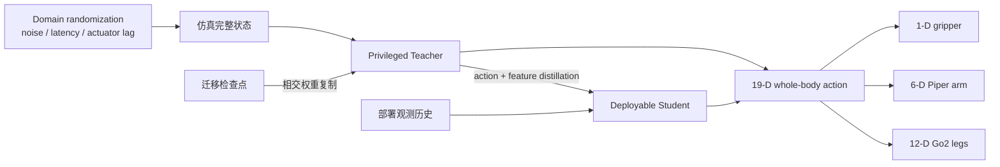

# TerrainCarry-RL

面向 Unitree Go2 + AgileX Piper 的紧耦合 whole-body 强化学习研究脚手架：用一个策略同时
输出 `12 leg + 6 arm + 1 gripper` 共 19 维动作，研究崎岖地形负载搬运中的迁移学习、
特权教师蒸馏与 Sim2Real 工程准备。

> **当前是可运行学习基础设施，不包含 Isaac Lab 资产或已验证真机策略。**
> 合成数据只用于 smoke test；当前结果不代表已运行 Isaac Lab、已完成 Sim2Real 或已验证
> 机器人性能。

_English summary: simulator-agnostic infrastructure for tightly coupled Go2 + Piper
policy transfer, privileged-to-deployable distillation, and reproducible Sim2Real tests._

## 项目定位

首版提供可单独测试的模型、检查点迁移、冻结计划、蒸馏训练、随机化/延迟/执行器近似与
评估基础设施。下游仿真项目负责资产、环境、接触、奖励、rollout 和硬件桥接，本仓库不复制
第三方源码、资产或权重。

## 架构



Teacher 读取部署可见信息以及地形、物体、接触力和动力学随机量等特权状态；Student
只读取部署观测历史。两者都可返回 19 维动作与中间特征。

### 为什么紧耦合

搬运时机械臂和载荷会持续改变四足系统的质心、惯量与接触需求。独立 locomotion 与
manipulation 策略只能在接口处被动协调；单一 whole-body 策略可以联合权衡落足、机身姿态、
末端轨迹和物体稳定性。代价是训练和安全约束更难，因此本项目显式保留可审计的 schema、
迁移报告与分阶段评估。

## 工作流

1. **迁移**：加载已有 locomotion/manipulation backbone；形状变化时复制相交权重，明确
   报告 loaded、missing、unexpected、shape mismatch，并先冻结后按 epoch 解冻。
2. **教师训练**：在下游模拟器中用完整仿真状态训练 19 维 privileged teacher。
3. **蒸馏**：用 action MSE、feature loss 和可选 uncertainty weighting，将教师蒸馏到
   只依赖部署观测历史的 student。
4. **Sim2Real 准备**：确定性采样质量、质心、摩擦、motor strength 和 noise，注入观测
   噪声、观测/动作延迟与一阶 actuator lag；按种子复现实验。
5. **评估**：聚合指标、保存 checkpoint，并在接入硬件前补齐系统辨识、安全限制和分层测试。

详见 [架构](docs/architecture.md)、[迁移学习](docs/transfer-learning.md)、
[策略蒸馏](docs/policy-distillation.md) 与 [Sim2Real](docs/sim2real.md)。

## 快速开始

需要 Python 3.11：

```bash
python3.11 -m venv .venv
source .venv/bin/activate
python -m pip install -e ".[dev]"
terrain-carry-rl smoke --config configs/smoke.json
pytest
ruff check .
```

`smoke` 仅执行短合成蒸馏、checkpoint 往返，并向 stdout 输出 JSON 指标。也可运行
`python examples/inspect_policy.py` 查看模型输入输出契约。

## 目录概览

- `src/terrain_carry_rl/models`：privileged teacher 与 history student；
- `transfer`：部分检查点迁移及 backbone 解冻计划；
- `distillation`：损失、合成 smoke 数据与短训练器；
- `sim2real`：随机化、噪声、延迟队列和执行器滞后；
- `evaluation`：指标聚合与 checkpoint roundtrip；
- `configs`：smoke、transfer、distill、sim2real 示例配置。

## 现状边界

- 已实现并测试 simulator-agnostic 学习基础设施；
- 未包含 Go2、Piper、地形或物体的 USD/URDF/MJCF 资产；
- 未接入 Isaac Lab 环境、RL rollout 或真实机器人通信；
- 未提供预训练权重、benchmark 成绩、安全认证或 Sim2Real 成功声明；
- 默认随机化范围是工程起点，不可替代系统辨识。

## 里程碑

- [x] 19 维 whole-body 策略、迁移/蒸馏/Sim2Real 基础组件
- [x] 合成 smoke test、单元测试和 CI
- [ ] 接入自有 Isaac Lab 任务与合法获取的机器人资产
- [ ] 完成 teacher RL 训练及 student rollout 蒸馏
- [ ] sim-to-sim 分层基准和系统辨识
- [ ] 带安全门控的 shadow mode 与真机逐级验证

## 相关上游

这些项目不随本仓库分发，接入前请核对各自许可证与资产条款：

- [NVIDIA Isaac Lab](https://github.com/isaac-sim/IsaacLab)
- [LeggedManip_Lab](https://github.com/zzzJie-Robot/LeggedManip_Lab)
- [RAMBO](https://github.com/catachiii/rambo)
- [locomanipulation-teleop-isaaclab](https://github.com/iit-DLSLab/locomanipulation-teleop-isaaclab)

## 许可

本项目以 [Apache License 2.0](LICENSE) 许可。第三方依赖与上游项目保留各自许可；详见
[THIRD_PARTY.md](THIRD_PARTY.md)。仓库不以 Apache-2.0 重新许可任何第三方资产或代码。
